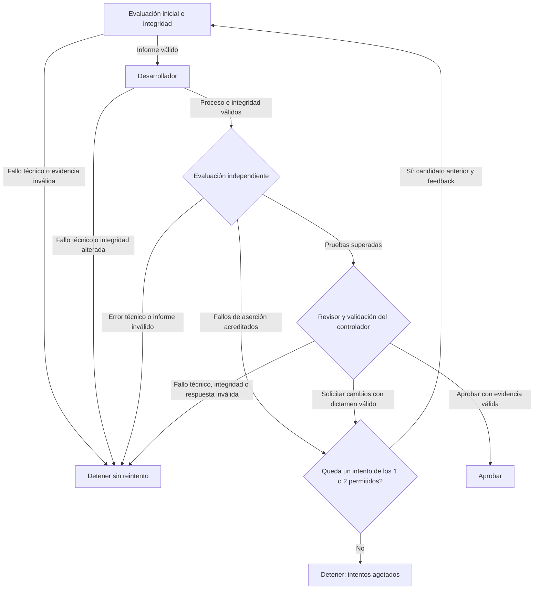

# code-review-orchestrator

Prototipo evaluado de orquestación de agentes para ejercicios de reparación de
código Python. Explora cómo separar la propuesta de un desarrollador, las
pruebas independientes, el dictamen de un revisor y la decisión de continuar
o detenerse, conservando la evidencia de cada etapa.

Está implementado un flujo local para **dos casos**, con **uno o dos intentos**
y **hasta cuatro invocaciones de agentes por ejecución**. Incluye controladores
de evaluación, reparación y revisión, un orquestador y un inspector de registros.
Los candidatos se guardan aparte; los defectos originales del benchmark se
conservan como punto de partida.

## Cómo funciona

El controlador fija contrato y pruebas, evalúa la partida y encarga al
desarrollador modificar una copia de `solution.py`. Después evalúa el candidato
en otro proceso Python. Solo cuando supera las pruebas y su evidencia es válida
lo entrega a un revisor en una sesión nueva de solo lectura. El controlador
decide a partir de esos resultados y de las comprobaciones de integridad.



Cada intento usa como máximo una invocación del desarrollador y una del
revisor. El presupuesto incluye el intento inicial: con dos intentos solo
cabe una corrección adicional. Un timeout, error técnico, fallo de registro
o evidencia inválida detiene el flujo aunque quede presupuesto; no hay
reintentos técnicos, concurrencia ni reanudación automática. Los límites son
180 s por agente, 30 s por evaluación y 10 s por consulta previa de CLI, sin
timeout global adicional. [Detalles del flujo](docs/funcionamiento.md#flujo-y-presupuesto).

## Casos y requisitos

| Caso | Contrato | Pruebas de referencia | Defecto inicial |
| --- | --- | --- | --- |
| `case_01` | [Suma por asignatura](tasks/001-sum-by-subject.md) | 4 | Sobrescribe los minutos de una asignatura repetida. |
| `case_02` | [Clasificación de ejecución, versión 2](tasks/002-classify-run.md) | 16 | Con código cero ignora si la respuesta está vacía. |

Para evaluar localmente, consultar registros y ejecutar la suite se necesita
Python 3 y su biblioteca estándar. El entorno documentado usó Python 3.12.3
en Linux; no se afirma compatibilidad comprobada con todas las versiones o
sistemas. No hay paquetes Python de terceros que instalar.

Para desarrollo y revisión reales se necesita además Codex CLI en `PATH`, con
autenticación ya configurada y acceso al servicio. La versión registrada en el
experimento fue `codex-cli 0.162.1`; no se garantiza compatibilidad con cualquier
versión. Los controladores comprueban la disponibilidad y las opciones de la CLI.
Necesitan escribir en `runs/` y crear workspaces temporales fuera del proyecto.

## Uso desde la raíz del proyecto

Para observar el defecto inicial **sin agentes**:

```bash
python3 -B run_case.py case_01
```

Se guarda una copia y su informe. Las pruebas originales tienen fallos
intencionados: 1 entre 4 en el caso 01 y 7 entre 16 en el caso 02. En esta CLI,
un código 0 significa que el proceso terminó y se conservó el registro;
el código de las pruebas se muestra aparte.

Para iniciar una ejecución **con agentes reales**:

```bash
python3 -B orchestrate_case.py case_01 --max-attempts 2
```

Sustituye `case_01` por `case_02` para el otro ejercicio; `--max-attempts` admite
1 o 2 y vale 2 por defecto. Cada lanzamiento crea registros nuevos. No aplica
el candidato al benchmark ni continúa un experimento anterior.

Al terminar, copia la ruta que imprime el orquestador en `Registro:`. Este
bloque Bash consulta **tu registro general**, incluso si la ejecución falló:

```bash
read -r -p 'Ruta mostrada por el orquestador en Registro: ' REGISTRO_ORQUESTACION
python3 -B inspect_run.py --run "$REGISTRO_ORQUESTACION"
```

El inspector muestra caso, estado, intentos, invocaciones, duración, pruebas,
dictamen, transiciones, errores y ubicaciones de evidencia. Los recuentos de
pruebas proceden de informes completos contrastados con las referencias
conservadas; las ausencias se muestran como «no consta» o «incompleto».
La **integridad registrada** es lo declarado por el controlador: el inspector
no recalcula hashes, audita candidatos ni ejecuta pruebas o agentes.

Sus códigos propios son **0** si pudo completar la consulta, aunque la
ejecución consultada fallara; **1** si faltan materiales necesarios o hay datos
inválidos; **2** para argumentos incorrectos. No deben confundirse con los
[códigos de los controladores](docs/funcionamiento.md#códigos-de-salida).
Las interfaces separadas de reparación y revisión se explican en la
[guía de funcionamiento](docs/funcionamiento.md#interfaces).

Extracto de la consulta histórica del caso 01, conservado de la documentación
anterior; no es una nueva ejecución:

```text
Caso: case_01
Estado del controlador: aprobada; código de la ejecución: 0
Intentos registrados: 1/2
Invocaciones registradas: desarrollador 1, revisor 1, total 2/4
Segundo intento: no registrado (no acredita corrección automática)
Consulta: completada (código 0)
```

## Pruebas automáticas (CI)

El [workflow de pruebas](.github/workflows/tests.yml) se ejecuta en pull requests
dirigidas a `main`, pushes a `main` y por lanzamiento manual desde GitHub Actions
(disponible cuando el workflow esté en la rama predeterminada). Usa Ubuntu 24.04
y Python 3.12, con un límite de 10 minutos y permisos `contents: read`.

Comprueba las pruebas existentes del controlador: evaluación, reparación,
revisión, orquestación, recorridos multicaso e inspección de registros. Codex se
simula con ejecutables temporales y parches; no se instala Codex, no se inicia
sesión, no se usan credenciales personales ni se llama a modelos. La suite crea
sus propios registros temporales y no depende de los registros locales de `runs/`.

Para ejecutar lo mismo localmente, desde la raíz del proyecto:

```bash
python3 -B -m unittest discover -s tests -v
```

El descubrimiento se limita a `tests/`: los originales de `benchmark/` contienen
defectos intencionados y no tienen que superar CI. La suite sigue evaluando sus
copias temporales y comprobando los resultados esperados. Un fallo de la suite
marca el job como fallido, conservando su código de salida.

Superar CI no demuestra la calidad general de los agentes. Mostrar un check
tampoco lo convierte automáticamente en obligatorio para hacer merge: eso
requiere configurarlo en las reglas o protecciones de la rama.

## Resultados observados

La validación local del **16 de octubre de 2026** ejecutó el comando de la
sección anterior con **Python 3.12.3: 126 pruebas correctas en 40,350 s,
código 0, sin llamadas reales al modelo**. Los datos se confirmaron en el
registro de esa ejecución; este ajuste documental no repite la suite. Es una
validación local: la ejecución real en GitHub Actions está pendiente al
preparar este cambio.

Como resultado histórico, la regresión anterior terminó con **126 pruebas
correctas en 40,147 s, código 0, sin llamadas reales al modelo**. Incluye 18
pruebas del inspector. En ambas validaciones los agentes usan una CLI simulada;
los procesos Python de evaluación sí se ejecutan.
[Historial de comprobaciones](docs/historial.md#comprobaciones-del-controlador).

El [experimento multicaso del 15 de octubre de 2026](evals/resultados-multicaso-2026-10-15.md)
consistió en una ejecución real por caso:

| Caso | Iniciales: correctas / fallidas | Posteriores | Dictamen / decisión del controlador | Intentos | Invocaciones |
| --- | --- | --- | --- | --- | --- |
| `case_01` | 3 / 1 | 4/4 correctas | `aprobar` / `aprobada`, código 0 | 1 de 2 | 1 desarrollador + 1 revisor |
| `case_02` | 9 / 7 | 16/16 correctas | `aprobar` / `aprobada`, código 0 | 1 de 2 | 1 desarrollador + 1 revisor |

**Cuatro invocaciones reales en total en este experimento. El segundo intento
automático no se ha observado con el modelo real.** Los comandos internos de
una sesión no cuentan como nuevas invocaciones. En el caso 02 quedó registrado
un comando interno fallido por ausencia de `python`, seguido de otro con
`python3`; no fue un segundo intento del orquestador.

<a id="ampliación-a-ambos-casos-15-de-octubre-de-2026"></a>

La ampliación multicaso se había validado antes con **108 pruebas correctas
en 39,797 s y Codex simulado**. Es una comprobación anterior a la incorporación
del inspector y distinta de las dos ejecuciones reales. El
[protocolo original](evals/protocolo-multicaso.md) conserva sus criterios y
presupuestos; su tabla pendiente refleja el diseño previo. Los
[hitos del 14 de octubre](evals/resultados-2026-10-14.md), incluidos un fallo
de inicialización y un dictamen de cambios bajo contrato v1, se conservan
por separado y no se reclasifican como aprobaciones.

## Qué queda sin demostrar

Dos ejercicios pequeños no acreditan fiabilidad general, una tasa de éxito
representativa ni corrección para todas las entradas. El caso 01 contiene
pistas explícitas del defecto en el contrato y el código: su reparación no
evalúa diagnóstico ciego. Las cuatro pruebas tampoco cubren por separado
nombres que solo difieren en mayúsculas.

La corrección automática, el agotamiento y las detenciones ante fallos tienen
cobertura simulada; las dos ejecuciones reales solo observaron aprobación
inicial. Pasar pruebas, recibir un dictamen y ser aprobado por el controlador
son observaciones distintas. La comprobación del experimento fue una
**revisión automática realizada por Codex**: no consta una revisión humana,
ni el modelo, proveedor o esfuerzo de razonamiento efectivos de esos agentes.
Las opciones de CLI conservadas no identifican toda la configuración efectiva.

El prototipo está destinado a estos ejercicios controlados. Los procesos de
pruebas usan los permisos del controlador y no heredan automáticamente el
sandbox de Codex. Las copias, los hashes y los timeouts no constituyen un
aislamiento para código arbitrario no confiable.

## Documentación y evidencia

- [Funcionamiento e interfaces](docs/funcionamiento.md): selección de caso,
  continuidad, formatos, códigos de salida y límites.
- [Historial y mapa de evaluación](docs/historial.md): hitos, comprobaciones
  simuladas, ejecuciones reales y enlaces a los informes originales.
- [Revisión para publicación](docs/revision-publicacion.md): alcance de la
  revisión de archivos e historial y datos personales detectados.
- [Pruebas del controlador](tests/), [contratos](tasks/), [benchmark](benchmark/)
  e [instrucciones de los revisores](prompts/).

Estos documentos y fuentes forman parte del contenido destinado a Git.
**`runs/` es evidencia local excluida de Git**: contiene salidas completas,
eventos, candidatos, copias y hashes. Los informes incluyen datos suficientes
para entender sus conclusiones sin esa carpeta; sus enlaces que apuntan a
`../runs/` solo funcionan con la evidencia local conservada. No son archivos
que deba contener un clon público. La guía de uso anterior utiliza las rutas
que genere cada persona, sin depender de registros históricos o directorios
personales. Los informes y las fuentes congeladas del experimento permanecen
intactos; esta documentación describe el árbol de trabajo actual.
