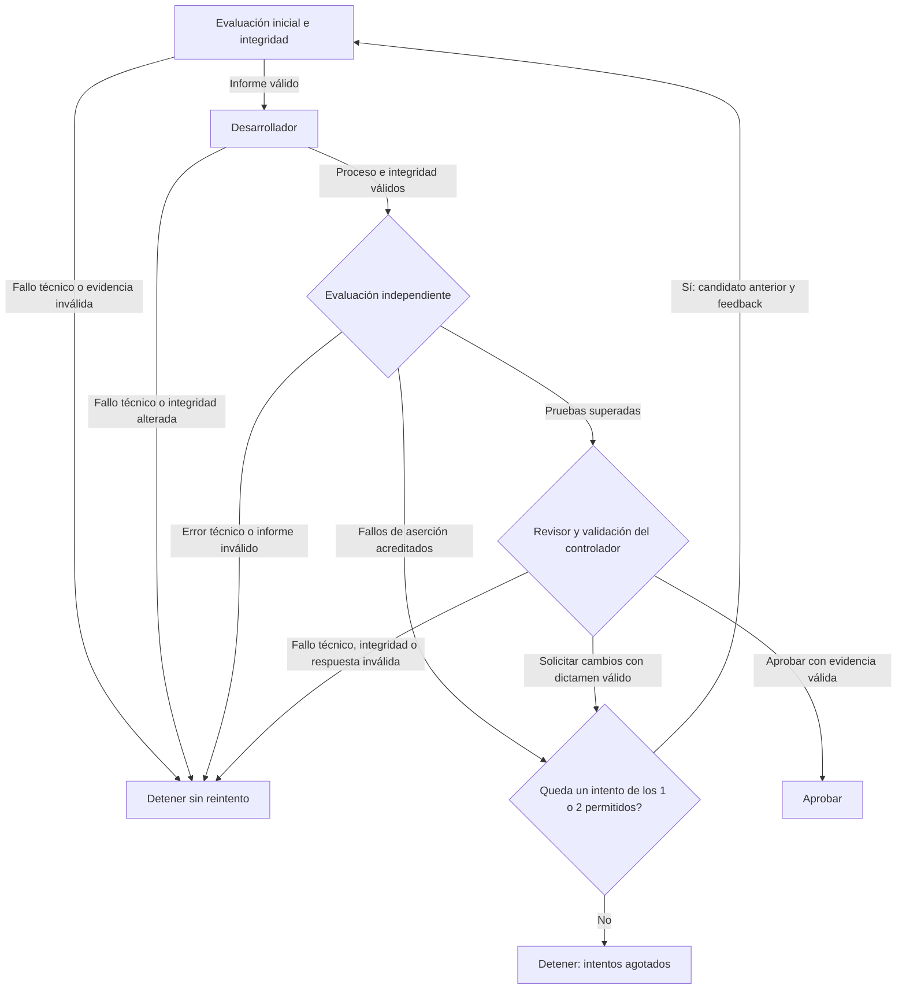

# code-review-orchestrator

Prototipo evaluado de orquestación de agentes para ejercicios de reparación de
código Python. Explora cómo separar la propuesta de un desarrollador, las
pruebas independientes, el dictamen de un revisor y la decisión de continuar
o detenerse, conservando la evidencia de cada etapa.

Está implementado un flujo local para **dos casos**, con **uno o dos intentos**
y **hasta cuatro invocaciones de agentes por ejecución**. Incluye controladores
de evaluación, reparación y revisión, un orquestador y un inspector de registros.
Los candidatos se guardan aparte; los defectos originales del benchmark se
conservan como punto de partida.

## Demo sin modelo

Desde un clon, con Python 3 y su biblioteca estándar, puedes consultar una
demostración sin credenciales, Codex ni registros personales:

```bash
python3 -B inspect_run.py --run examples/inspect_run/aprobada
python3 -B inspect_run.py --run examples/inspect_run/aprobada --format json
```

Ambos comandos completan la consulta con código **0**. Sustituye `aprobada` por
`fallo_agente` para consultar con código **0** una ejecución registrada con
código **3**, o por `incompleta` para obtener código **1** por un informe ausente.
En JSON, las incidencias quedan en `consulta.incidencias`; el código del inspector
es `consulta.codigo_salida` y el registrado es `ejecucion.codigo_salida`.

Todos los registros, dictámenes, contadores e informes son **datos sintéticos**:
no proceden de ejecuciones de agentes ni acreditan pruebas ejecutadas. Sirven
exclusivamente para consultar con el inspector; no son registros autorizados
para reparar o revisar candidatos. Consulta la [guía y procedencia de la demo](examples/inspect_run/README.md).

## Cómo funciona

El controlador fija contrato y pruebas, evalúa la partida y encarga al
desarrollador modificar una copia de `solution.py`. Después evalúa el candidato
en otro proceso Python. Solo cuando supera las pruebas y su evidencia es válida
lo entrega a un revisor en una sesión nueva de solo lectura. El controlador
decide a partir de esos resultados y de las comprobaciones de integridad.



Cada intento usa como máximo una invocación del desarrollador y una del
revisor. El presupuesto incluye el intento inicial: con dos intentos solo
cabe una corrección adicional. Un timeout, error técnico, fallo de registro
o evidencia inválida detiene el flujo aunque quede presupuesto; no hay
reintentos técnicos, concurrencia ni reanudación automática. Los límites son
180 s por agente, 30 s por evaluación y 10 s por consulta previa de CLI, sin
timeout global adicional. [Detalles del flujo](docs/funcionamiento.md#flujo-y-presupuesto).

## Casos y requisitos

| Caso | Contrato | Pruebas de referencia | Defecto inicial |
| --- | --- | --- | --- |
| `case_01` | [Suma por asignatura](tasks/001-sum-by-subject.md) | 4 | Sobrescribe los minutos de una asignatura repetida. |
| `case_02` | [Clasificación de ejecución, versión 2](tasks/002-classify-run.md) | 16 | Con código cero ignora si la respuesta está vacía. |

Para evaluar localmente, consultar registros y ejecutar la suite se necesita
Python 3 y su biblioteca estándar. El entorno documentado usó Python 3.12.3
en Linux; no se afirma compatibilidad comprobada con todas las versiones o
sistemas. No hay paquetes Python de terceros que instalar.

Para desarrollo y revisión reales se necesita además Codex CLI en `PATH`, con
autenticación ya configurada y acceso al servicio. La versión registrada en el
experimento fue `codex-cli 0.162.1`; no se garantiza compatibilidad con cualquier
versión. Los controladores comprueban la disponibilidad y las opciones de la CLI.
Necesitan escribir en `runs/` y crear workspaces temporales fuera del proyecto.

Los procesos de evaluación reciben un entorno mínimo y configuración temporal;
Codex usa una lista permitida distinta para conservar su autenticación. Consulta
las [políticas, revisión de credenciales y límites](docs/credenciales-y-entornos.md).
Este filtrado no constituye aislamiento del sistema de archivos o de la red.

## Uso desde la raíz del proyecto

Para observar el defecto inicial **sin agentes**:

```bash
python3 -B run_case.py case_01
```

Se guarda una copia y su informe. Las pruebas originales tienen fallos
intencionados: 1 entre 4 en el caso 01 y 7 entre 16 en el caso 02. En esta CLI,
un código 0 significa que el proceso terminó y se conservó el registro;
el código de las pruebas se muestra aparte.

Para iniciar una ejecución **con agentes reales**:

```bash
python3 -B orchestrate_case.py case_01 --max-attempts 2
```

Sustituye `case_01` por `case_02` para el otro ejercicio; `--max-attempts` admite
1 o 2 y vale 2 por defecto. Cada lanzamiento crea registros nuevos. No aplica
el candidato al benchmark ni continúa un experimento anterior.

Al terminar, copia la ruta que imprime el orquestador en `Registro:`. Este
bloque Bash consulta **tu registro general**, incluso si la ejecución falló:

```bash
read -r -p 'Ruta mostrada por el orquestador en Registro: ' REGISTRO_ORQUESTACION
python3 -B inspect_run.py --run "$REGISTRO_ORQUESTACION"
python3 -B inspect_run.py --run "$REGISTRO_ORQUESTACION" --format json
```

El inspector muestra caso, estado, intentos, invocaciones, duración, pruebas,
dictamen, transiciones, errores y ubicaciones de evidencia. Los recuentos de
pruebas proceden de informes completos contrastados con las referencias
conservadas; las ausencias se muestran como «no consta» o «incompleto».
La **integridad registrada** es lo declarado por el controlador: el inspector
no recalcula hashes, audita candidatos ni ejecuta pruebas o agentes.

Sus códigos propios son **0** si pudo completar la consulta, aunque la
ejecución consultada fallara; **1** si faltan materiales necesarios o hay datos
inválidos; **2** para argumentos incorrectos. No deben confundirse con los
[códigos de los controladores](docs/funcionamiento.md#códigos-de-salida).
Las interfaces separadas de reparación y revisión se explican en la
[guía de funcionamiento](docs/funcionamiento.md#interfaces).

La exportación **`--format json` ya está incorporada localmente**. Devuelve un
único objeto del [esquema v1](tasks/003-inspect-run-json.md), también en consultas
incompletas, con incidencias dentro del objeto y stderr vacío. `consulta.codigo_salida`
coincide con el código del inspector; `ejecucion.codigo_salida` conserva el del
registro. Por ejemplo, una ejecución fallida con código 3 puede consultarse con
código 0. Los valores desconocidos se conservan como `null`. Los argumentos
inválidos devuelven 2, stdout vacío y diagnóstico en stderr. Omitir `--format`
o usar `--format text` mantiene la presentación textual anterior.

Las advertencias del análisis AST de referencias válidas (por ejemplo, el escape
`"\d"`) se filtran temporalmente al comprobar informes en JSON. No alteran los
datos ni convierten la consulta en incompleta. Los errores reales de lectura o
sintaxis siguen generando incidencias y código 1. Texto conserva sus advertencias;
los filtros se restauran al salir del ámbito, también ante una excepción.

La [exportación CSV](evals/tareas_reales/export_csv/README.md) está incorporada
localmente y usa solo biblioteca estándar:

```bash
python3 -B export_runs.py consulta_1.json consulta_2.json
```

Cada archivo debe contener un objeto completo del esquema JSON v1 del inspector.
Conserva el orden, los argumentos repetidos y su texto literal en `origen`; los
desconocidos producen celdas vacías, distintas de cero. Valida todas las entradas
antes de escribir la cabecera y las filas CSV. No recibe directamente registros
ni el JSON general del orquestador de proyectos, y no invoca el inspector.

El código del exportador es **0** al completar el CSV, **1** ante entradas
ilegibles o inválidas, y **2** ante argumentos incorrectos. Los errores no dejan
CSV parcial. `-h` y `--help` muestran ayuda con código 0. Estos códigos son
independientes de las columnas `consulta_codigo_salida` y
`ejecucion_codigo_salida`: una consulta incompleta o ejecución fallida válida
también puede exportarse con código 0.

La entrega procede de un desarrollo y una revisión reales, con aprobación sin
hallazgos. Después recibió un [contraste automático asistido por Codex](evals/tareas_reales/export_csv/contraste-real-2026-10-19.md)
y autorización explícita para incorporar sus bytes exactos como archivo 0644.
La [guía CSV](evals/tareas_reales/export_csv/README.md#incorporación-explícita-y-cobertura-permanente)
conserva el SHA-256, procedencia y validación local, separados de las simulaciones
previas. La incorporación no reanuda la orquestación ni modifica sus registros.

La [tarea inspect-json](evals/tareas_reales/inspect_json/README.md) comenzó con un
desarrollo mediante el adaptador sobre una copia. Su rechazo inicial se conserva:
la [reevaluación](evals/tareas_reales/inspect_json/reevaluacion-2026-10-17.md) ajustó
una exigencia literal del evaluador que el contrato no imponía. Tras un timeout,
la segunda revisión solicitó cambios por booleanos y duraciones; fueron
contrastados y corregidos mediante asistencia de Codex bajo instrucciones del
usuario. Otra revisión estática detectó el desbordamiento de recursión, después
reproducido y corregido mediante comparación iterativa. La revisión del último
diff se realizó en esta conversación y se autorizó incorporar esa entrega exacta.
No fue una aprobación emitida por el controlador ni demuestra un ciclo automático
completo de esta tarea. La [secuencia y sus límites](evals/tareas_reales/inspect_json/revision.md)
conservan los dictámenes históricos y distinguen las correcciones asistidas.

El nuevo [flujo acotado de proyectos](docs/orquestacion-proyectos.md) conecta
desarrollo, evaluación, revisión y una posible corrección para `inspect-json`:

```bash
python3 -B orchestrate_project.py inspect-json --max-attempts 2
```

El flujo se comprobó inicialmente con agentes simulados y reproduce la base
conocida del contrato 003,
aunque `main` ya tenga JSON. Cada candidato debe superar aceptación revisada,
regresión de la base y comprobaciones públicas de booleanos, duración grande y
anidamiento. Una aprobación lo deja listo para revisión humana; no lo incorpora.
Permite como máximo dos llamadas por rol, con reservas persistentes y sin
reintentos técnicos. Conserva la validación histórica de `review_project.py` y
añade una vía explícita para entregas nuevas. Sus registros requieren un lector
JSON general: el esquema y el inspector integrado permanecen iguales.
La [primera ejecución real](evals/tareas_reales/inspect_json/orquestacion-real-2026-10-18.md)
acreditó una corrección automática tras pruebas fallidas y se detuvo por timeout
del revisor, código 4, sin dictamen final ni incorporación.

También se puede solicitar una [revisión aislada de un intento
terminado](docs/orquestacion-proyectos.md#revisión-aislada-de-una-entrega-terminada)
con `review_project.py --orchestration-run ... --attempt 2 --operation-id ...`.
Usa registro propio y una única reserva del revisor; no repite desarrollos ni
evaluaciones, no reanuda el origen y no incorpora entregas. `--review-timeout`
admite 60–600 segundos y conserva 180 por defecto. La guía documenta la revisión
adicional de la segunda entrega real con 300 segundos: solicitó cambios y el
[contraste automático asistido](evals/tareas_reales/inspect_json/orquestacion-real-2026-10-18.md#revisión-adicional-y-contraste-de-sus-hallazgos)
confirmó dos defectos. La entrega experimental sigue sin incorporar; el inspector
ya integrado permanece intacto. El resultado original continúa siendo código 4.

Extracto de la consulta histórica del caso 01, conservado de la documentación
anterior; no es una nueva ejecución:

```text
Caso: case_01
Estado del controlador: aprobada; código de la ejecución: 0
Intentos registrados: 1/2
Invocaciones registradas: desarrollador 1, revisor 1, total 2/4
Segundo intento: no registrado (no acredita corrección automática)
Consulta: completada (código 0)
```

## Pruebas automáticas (CI)

El [workflow de pruebas](.github/workflows/tests.yml) se ejecuta en pull requests
dirigidas a `main`, pushes a `main` y por lanzamiento manual desde GitHub Actions
(disponible cuando el workflow esté en la rama predeterminada). Usa Ubuntu 24.04
y Python 3.12, con un límite de 10 minutos y permisos `contents: read`.

Comprueba las pruebas existentes del controlador: evaluación, reparación,
revisión, orquestación, recorridos multicaso e inspección de registros. La
[cobertura JSON permanente](tests/test_inspect_json.py) reutiliza aceptación,
hallazgos y anidamiento con datos sintéticos: esquema, códigos y canales,
desconocidos, valores inválidos, booleanos, enteros grandes y estructuras
profundas, además de compatibilidad textual. La [aceptación CSV permanente](tests/test_export_csv.py)
añade los 17 métodos del evaluador por CLI y sus [controles permanentes](tests/test_export_csv_evaluator.py)
añaden las 17 comprobaciones con respuestas prefijadas, incluida equivalencia
decimal exacta. Los adaptadores heredan las aserciones sin duplicarlas: cada
método aparece individualmente en unittest y el exportador no se importa en el
proceso de pruebas. No necesita ejecutar otra vez esos evaluadores por separado. Codex se
simula con ejecutables temporales y parches; no se instala Codex, no se inicia
sesión, no se usan credenciales personales ni se llama a modelos. La suite crea
sus propios registros temporales y no depende de los registros locales de `runs/`.

Para ejecutar lo mismo localmente, desde la raíz del proyecto:

```bash
python3 -B -m unittest discover -s tests -v
```

La validación local del 17 de octubre de 2026 ejecutó ese comando una vez sobre
el árbol actual: **238 métodos superados**, incluidos 29 de la nueva cobertura
JSON, sin fallos ni errores y con código 0. Es el descubrimiento principal;
las evaluaciones auxiliares de los fixtures no se suman a ese total. Este
resultado no es una ejecución remota de GitHub Actions ni la regresión congelada
de 153 métodos de la tarea.

La validación local posterior de la demo, también del **17 de octubre de 2026**,
obtuvo **242 métodos correctos en 73,015 segundos, código 0**: los **238 anteriores
y cuatro nuevos** de [integración de la demo](tests/test_inspect_demo.py).
Se conserva ese resultado ya obtenido; este ajuste documental no repite la suite.
Las pruebas nuevas consultan los ejemplos sin ejecutar sus referencias. Los
informes sintéticos de los ejemplos no acreditan pruebas realmente ejecutadas
ni se suman a estos recuentos. Esta validación local es distinta de la CI remota.

El **18 de octubre de 2026**, la regresión completa del nuevo flujo de proyectos
superó **262 métodos en 132,736 segundos, código 0**: los 242 anteriores y 20
escenarios nuevos con agentes simulados. También se comprobó una corrección
sobre la base real congelada y los evaluadores públicos, con dos desarrollos y
una revisión simulados, sin modelos reales ni incorporación de candidatos.
La [guía del flujo](docs/orquestacion-proyectos.md) detalla evidencia, consumos
y limitaciones; no cambia los resultados históricos anteriores.

Al añadir la revisión aislada pasaron **281 métodos** de regresión local. Tras
el último refuerzo del validador pasaron **19 métodos enfocados**; la regresión
completa anterior no se atribuye a ese cambio posterior. Son comprobaciones
con agentes simulados, separadas del experimento real descrito en el informe.

El **19 de octubre de 2026**, con **Python 3.12.3**, se reprodujo la fuga de
advertencias AST a stderr del inspector publicado. Base:
`c8a38c9bfb7d8105371567d8b7a6854d1f048d33`; SHA-256 inicial de `inspect_run.py`:
`8abca5003639de7ddbed2c5f242c60d2a030be2548538b5f2a0b1507e78e7b87`.
La nueva prueba permanente se ejecutó **antes de corregir el inspector**:

```bash
python3 -B -m unittest discover -s tests -p test_inspect_json.py -k test_json_escape_no_reconocido -v
```

Resultado inicial: **1 prueba, 1 fallo, código 1 del unittest**. La CLI hija
devolvió código 0, consulta completada y el mismo objeto JSON que el control,
pero la aserción de stderr vacío falló por `SyntaxWarning`. El fixture añadió
`patron = "\d"` mediante bytes crudos a referencias sintéticas, sin ejecutar su
contenido ni forzar filtros de advertencias en el proceso hijo. Los inventarios
de contenido y metadatos permanecieron intactos. Es una reproducción local con
3.12.3, distinta de la reproducción previa comunicada con 3.12.14.

Tras la corrección, **62 pruebas enfocadas superadas en 4,400 s, código 0**:

```bash
python3 -B -m unittest discover -s tests -p 'test_inspect*.py' -v
```

Los cinco métodos nuevos cubren control y escape no reconocido por CLI,
sintaxis inválida con incidencia localizada y código 1, texto predeterminado,
`--format text`, `inspect_run(run_dir)` y restauración de filtros con políticas
`always`, `error` e `ignore`. Un fallo inesperado inyectado en el analizador se
propaga y también restaura los filtros. No se modifica `case_evidence.py`, los
evaluadores históricos ni las autoridades congeladas del experimento rechazado.

La regresión completa posterior (`python3 -B -m unittest discover -s tests -v`)
superó **286 métodos en 145,628 s, código 0**, sin fallos ni errores. Incluye
booleanos frente a números, enteros grandes y comparación anidada. Son pruebas
locales con agentes simulados, sin nuevas ejecuciones reales ni reanudación del
experimento; no se atribuyen a una ejecución remota de CI.

Tras incorporar explícitamente CSV el **19 de octubre de 2026**, se ejecutó
una sola vez el descubrimiento completo con **Python 3.12.3**: **355 métodos
correctos en 182,354 s, código 0**, sin fallos, errores ni omisiones. Incluye
17 métodos de aceptación CSV y 17 controles del evaluador, cada uno descubierto
una vez. No se repitió la aceptación por separado. Este resultado local del
árbol incorporado se distingue de las 321 pruebas históricas de preparación y
las 286 de la base congelada; no acredita una ejecución remota de Actions.
La [guía CSV](evals/tareas_reales/export_csv/README.md#incorporación-explícita-y-cobertura-permanente)
identifica la evidencia local. Los cambios posteriores a esta validación son
exclusivamente documentales.

El descubrimiento se limita a `tests/`: los originales de `benchmark/` contienen
defectos intencionados y no tienen que superar CI. La suite sigue evaluando sus
copias temporales y comprobando los resultados esperados. Un fallo de la suite
marca el job como fallido, conservando su código de salida.

Superar CI no demuestra la calidad general de los agentes. Mostrar un check
tampoco lo convierte automáticamente en obligatorio para hacer merge: eso
requiere configurarlo en las reglas o protecciones de la rama.

## Resultados observados

La validación local del **16 de octubre de 2026** ejecutó el comando de la
sección anterior con **Python 3.12.3: 126 pruebas correctas en 40,350 s,
código 0, sin llamadas reales al modelo**. Los datos se confirmaron en el
registro de esa ejecución; este ajuste documental no repite la suite. Es una
validación local: la ejecución real en GitHub Actions está pendiente al
preparar este cambio.

Como resultado histórico, la regresión anterior terminó con **126 pruebas
correctas en 40,147 s, código 0, sin llamadas reales al modelo**. Incluye 18
pruebas del inspector. En ambas validaciones los agentes usan una CLI simulada;
los procesos Python de evaluación sí se ejecutan.
[Historial de comprobaciones](docs/historial.md#comprobaciones-del-controlador).

El [experimento controlado del revisor del 16 de octubre de 2026](evals/revisor/resultados-2026-10-16.md)
registra cuatro revisiones reales de candidatos preparados: dos defectos
detectados y dos aprobaciones justificadas mediante contraste automático de
contratos, código y hallazgos. Es distinto de las 148 pruebas previas con Codex
simulado y de la [validación posterior del progreso](evals/revisor/README.md#validación-local-del-lanzador):
153 pruebas automatizadas, también sin llamadas reales al modelo. El informe
distingue los mensajes intermedios observados del JSON
final válido y matiza la interpretación de la exclusividad del formato;
no acredita fiabilidad general ni un segundo intento de reparación.

El [experimento multicaso del 15 de octubre de 2026](evals/resultados-multicaso-2026-10-15.md)
consistió en una ejecución real por caso:

| Caso | Iniciales: correctas / fallidas | Posteriores | Dictamen / decisión del controlador | Intentos | Invocaciones |
| --- | --- | --- | --- | --- | --- |
| `case_01` | 3 / 1 | 4/4 correctas | `aprobar` / `aprobada`, código 0 | 1 de 2 | 1 desarrollador + 1 revisor |
| `case_02` | 9 / 7 | 16/16 correctas | `aprobar` / `aprobada`, código 0 | 1 de 2 | 1 desarrollador + 1 revisor |

**Cuatro invocaciones reales en total en este experimento. El segundo intento
automático no se ha observado con el modelo real.** Los comandos internos de
una sesión no cuentan como nuevas invocaciones. En el caso 02 quedó registrado
un comando interno fallido por ausencia de `python`, seguido de otro con
`python3`; no fue un segundo intento del orquestador.

<a id="ampliación-a-ambos-casos-15-de-octubre-de-2026"></a>

La ampliación multicaso se había validado antes con **108 pruebas correctas
en 39,797 s y Codex simulado**. Es una comprobación anterior a la incorporación
del inspector y distinta de las dos ejecuciones reales. El
[protocolo original](evals/protocolo-multicaso.md) conserva sus criterios y
presupuestos; su tabla pendiente refleja el diseño previo. Los
[hitos del 14 de octubre](evals/resultados-2026-10-14.md), incluidos un fallo
de inicialización y un dictamen de cambios bajo contrato v1, se conservan
por separado y no se reclasifican como aprobaciones.

## Qué queda sin demostrar

Dos ejercicios pequeños no acreditan fiabilidad general, una tasa de éxito
representativa ni corrección para todas las entradas. El caso 01 contiene
pistas explícitas del defecto en el contrato y el código: su reparación no
evalúa diagnóstico ciego. Las cuatro pruebas tampoco cubren por separado
nombres que solo difieren en mayúsculas.

La corrección automática, el agotamiento y las detenciones ante fallos tienen
cobertura simulada; las dos ejecuciones multicaso del 15 de octubre solo
observaron aprobación inicial. Pasar pruebas, recibir un dictamen y ser aprobado
por el controlador son observaciones distintas. La comprobación del experimento fue una
**revisión automática realizada por Codex**: no consta una revisión humana,
ni el modelo, proveedor o esfuerzo de razonamiento efectivos de esos agentes.
Las opciones de CLI conservadas no identifican toda la configuración efectiva.

El prototipo está destinado a estos ejercicios controlados. Los procesos de
pruebas usan los permisos del controlador y no heredan automáticamente el
sandbox de Codex. Las copias, los hashes y los timeouts no constituyen un
aislamiento para código arbitrario no confiable.

## Documentación y evidencia

- [Funcionamiento e interfaces](docs/funcionamiento.md): selección de caso,
  continuidad, formatos, códigos de salida y límites.
- [Historial y mapa de evaluación](docs/historial.md): hitos, comprobaciones
  simuladas, ejecuciones reales y enlaces a los informes originales.
- [Revisión para publicación](docs/revision-publicacion.md): alcance de la
  revisión de archivos e historial y datos personales detectados.
- [Evaluación controlada del revisor](evals/revisor/README.md): candidatos,
  comprobaciones locales y protocolo previo, con enlace a los resultados reales
  del 16 de octubre.
- [Pruebas del controlador](tests/), [contratos](tasks/), [benchmark](benchmark/)
  e [instrucciones de los revisores](prompts/).

Estos documentos y fuentes forman parte del contenido destinado a Git.
**`runs/` es evidencia local excluida de Git**: contiene salidas completas,
eventos, candidatos, copias y hashes. Los informes incluyen datos suficientes
para entender sus conclusiones sin esa carpeta; sus enlaces que apuntan a
`../runs/` solo funcionan con la evidencia local conservada. No son archivos
que deba contener un clon público. La guía de uso anterior utiliza las rutas
que genere cada persona, sin depender de registros históricos o directorios
personales. Los informes y las fuentes congeladas del experimento permanecen
intactos; esta documentación describe el árbol de trabajo actual.
